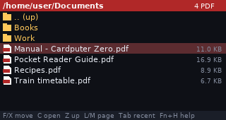
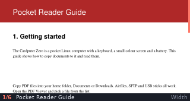
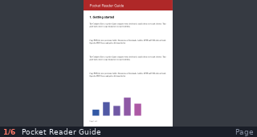
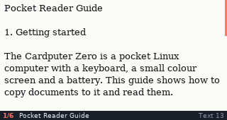
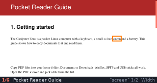
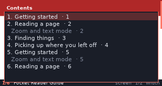

[](https://github.com/H4W9/CardputerZero_PDFViewer/actions/workflows/build.yml)

# PDF Viewer for the Cardputer Zero

Read PDF files on the M5Stack Cardputer Zero. It is an APPLaunch app and shows up in the launcher as **PDF Viewer**.

 
 
 

## What it does

- File list with folders and PDF files, recent files, and shortcuts to home folders, Downloads and USB sticks
- Fit width, whole page, zoom, rotate, night colours
- Scrolling runs from one page into the next
- Text mode: the page's words wrapped to fit the screen, size adjustable
- Search across the document, matches outlined on the page
- Contents list from the PDF outline, go to page
- Password protected PDFs
- Remembers the page, zoom and rotation for every file
- Draws on the 2.8in EXT display when DisplayMOD has it running, with the built-in screen showing its own full-size view

## Keys

Press **Fn+H** for the full list on the device.

| Key | Viewer |
| --- | --- |
| F / X (Up / Down) | scroll |
| Z / C (Left / Right) | pan, or turn the page when it fits |
| L / M (PgUp / PgDn) | previous / next page |
| Space, Enter / Bksp | next / previous screen |
| `,` `.` | previous / next page |
| G or a number | go to page |
| `+` `-` W P | zoom in, zoom out, fit width, whole page |
| R / I / T | rotate / night colours / text mode |
| `/` or S, N, Shift+N | search, next match, previous match |
| O / D | contents / document info |
| Tab | hide the status bar |
| B / Q / Esc | file list / quit / back |

F X Z C and L M work as the arrow and page keys printed on them (no Fn needed) everywhere except where you type text.

In the file list: F / X move, C or Enter opens, Z or Bksp goes up a folder, L / M page. Other letters jump to a name (Shift+letter for names starting with F, X, Z, C, L or M). Tab shows recent files, `'` shows places.

## Install

Get it from the Cardputer Zero app store (share code **PDFV**), or download the .deb from [Releases](https://github.com/H4W9/CardputerZero_PDFViewer/releases) and run:

```
sudo apt install ./czpdf_0.1.2-m5stack1_all.deb
```

It needs `python3-pil` and a PDF renderer: `python3-pymupdf` (preferred, Debian 13) or `poppler-utils`. apt pulls them in.

Copy PDFs to the device with Airfiles, SFTP or a USB stick. The file list starts in your Documents or Downloads folder.

## Opening a file directly

```
/usr/share/APPLaunch/bin/czpdf /home/user/Documents/file.pdf [--page N]
```

Opened this way, Esc closes the viewer instead of going to the file list.

## Opening PDFs from the Files app

The stock Files app can't hand files to other apps yet. [files-integration/](files-integration/) has a patch for [CardputerZero/Files](https://github.com/CardputerZero/Files) that adds this: Files starts any installed app whose launcher entry lists the file type. PDF Viewer's entry declares `MimeType=application/pdf;`, so with a patched Files a PDF opens here and Esc goes back to Files.

## Build

```
python tools/build_deb.py          # dist/czpdf_<version>-m5stack1_all.deb
python -m unittest discover -s tests
python -m czpdf --window           # desktop preview (Tk); --ext for 320x240
python -m czpdf --screenshots store/screenshots
```

`tools\deploy.cmd <ip> <user>` copies the newest .deb to the device and installs it.

GitHub Actions runs the tests and builds the .deb on every push (download it from the run's artifacts). To make a release, bump the version in `packaging/meta.env`, `czpdf/__init__.py` and `app-builder.json`, then push a tag `v<version>`, or run the Build workflow by hand with "Draft a release" ticked. Either way you get a draft release with the .deb attached, to check and publish.

## License

MIT
